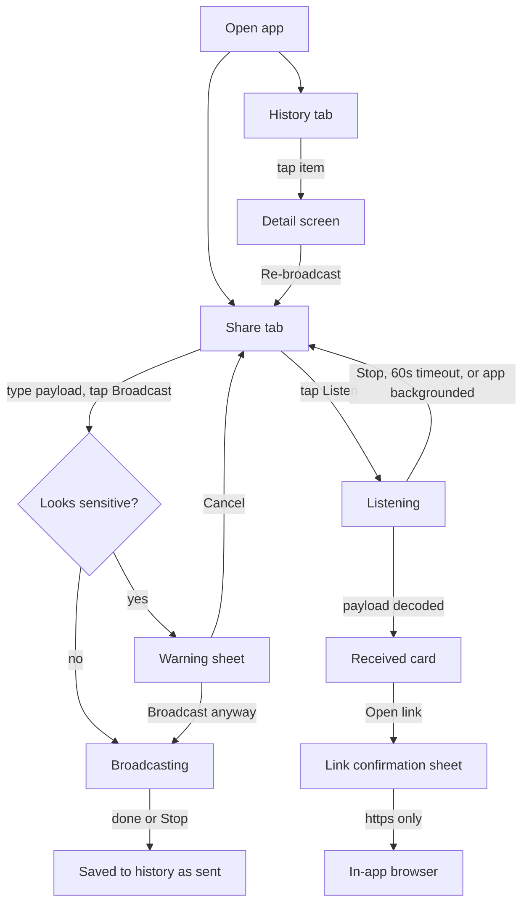
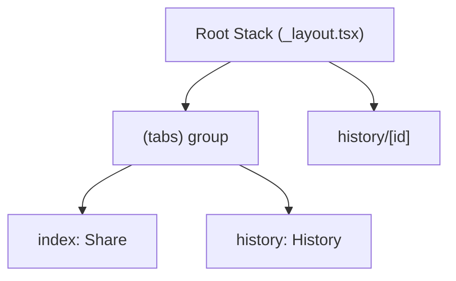
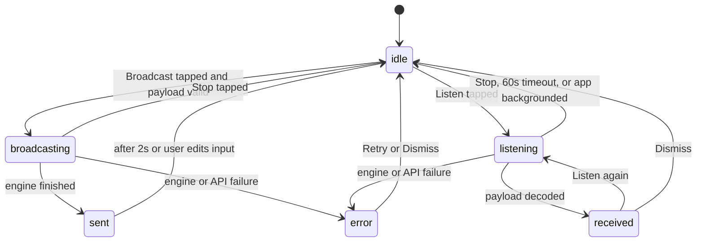

# Audio Share App: Frontend Plan

Status: draft, revision 2 (adds the security review and expands the details)
Scope: **frontend only**. The audio engine and backend are mocked.
Stack: Expo SDK 57, Expo Router (typed routes enabled), React Native 0.86, Reanimated 4, TypeScript.

---

## 1. Product summary

The app sends short pieces of text or links **over sound** ("data over sound"). One phone plays a sequence of tones, and nearby phones that are listening decode them. The app has two main tabs:

1. **Share** (default tab): type a message and broadcast it, or listen for messages from nearby devices.
2. **History**: a log of everything this device has sent or received, with filtering and actions.

A **Detail** screen shows one history entry in full.

### Decisions captured
- An "audio code" means data over sound (tones), not a visual QR code.
- Broadcast and Listen live on the same screen. Only one runs at a time.
- History shows both sent and received items, with an All / Sent / Received filter.
- History item actions: re-broadcast, copy, open link (URLs only), and tap to open details.
- Pseudo backend: **json-server** serving `db.json`. Audio: a **mock sound engine**.
- Theme: orange and white, with dark-mode support.

### Out of scope
- Real tone encoding and decoding (FSK and similar), and microphone DSP
- Accounts, authentication, and cloud sync
- Push notifications

---

## 2. User flows



---

## 3. File structure

```
project-spec/
  frontend-plan.md          <- this document
mock-server/
  db.seed.json              committed seed data
  db.json                   runtime copy (gitignored)
  reset-db.js               copies seed to db.json
src/
  app/
    _layout.tsx             root Stack + ThemeProvider + splash + providers
    (tabs)/
      _layout.tsx           renders AppTabs
      index.tsx             Share screen
      history.tsx           History screen
    history/
      [id].tsx              Detail screen
  components/
    app-tabs.tsx            native tabs (updated)
    app-tabs.web.tsx        web tabs (updated)
    primary-button.tsx
    segmented-control.tsx
    transmission-card.tsx
    waveform.tsx
    pulse-ring.tsx
    status-badge.tsx
    payload-input.tsx
    link-confirm-sheet.tsx
    sensitive-warning-sheet.tsx
    toast.tsx
  constants/
    theme.ts                extended palette
    limits.ts               payload limits, timeouts, poll intervals
  hooks/
    use-broadcast.ts
    use-listen.ts
    use-transmissions.ts
    use-transmission.ts
  services/
    api.ts                  fetch wrapper with timeout and validation
    sound-engine.ts         SoundEngine interface + MockSoundEngine
    device-id.ts            random per-load id (in memory)
  state/
    share-draft.tsx         in-memory context for re-broadcast prefill
    toast.tsx               ToastProvider + useToast
  types/
    transmission.ts
  utils/
    payload.ts              sanitize, classify, URL safety checks
    sensitive.ts            heuristics for secrets
    format.ts               relative time, durations
```

### Reusing the Expo starter
The build starts from the existing Expo template and extends it instead of replacing it:
- **Keep and reuse:** `ThemedText`, `ThemedView`, `useTheme`, `useColorScheme` (native and web), `Colors`, `Fonts`, `Spacing`, `BottomTabInset`, `MaxContentWidth`, `AnimatedSplashOverlay`, and `global.css`.
- **Extend:** `theme.ts` (new color tokens added alongside the existing ones), `ThemedText` (add a `button` type if needed), `app-tabs.tsx` and `app-tabs.web.tsx` (keep their structure and swap in the two new tabs). Also extend `TabButton`/`CustomTabList` with the orange active state.
- **Repurpose:** `src/app/index.tsx` becomes the Share screen (moved into `(tabs)/`), and `src/app/explore.tsx` becomes `(tabs)/history.tsx`. Use `AnimatedIcon` as the empty-state illustration on History.
- **Remove only when unused:** `hint-row`, `web-badge`, `collapsible`, `external-link`, and the `reset-project` script.

---

## 4. Routing (Expo Router)



- Root `_layout.tsx`: `Stack` with `(tabs)` (header hidden) and `history/[id]` (header shown, title "Details", back button). Wraps everything in `ThemeProvider` and `ShareDraftProvider`, and keeps `AnimatedSplashOverlay`.
- `(tabs)/_layout.tsx`: renders `AppTabs`.
- `app-tabs.tsx` (native): two `Tabs.Screen` entries, `index` (title "Share", icon `waveform`) and `history` (title "History", icon `clock.arrow.circlepath`). Active tint is `colors.primary`.
- `app-tabs.web.tsx`: same two triggers, with `href="/"` and `href="/history"`. Replace "Expo Starter" with the app name and remove the Docs link.
- **Re-broadcast prefill uses the in-memory `ShareDraftProvider`, not URL params.** This means an external deep link such as `apptesting://?payload=...` cannot inject content into the Share input (see the security section).
- Before implementing, check the SDK 57 Expo Router docs for current `Stack` and `Tabs` APIs (per AGENTS.md).

---

## 5. Screens

### 5.1 Share (`(tabs)/index.tsx`)

**State machine**



**Layout: Send / Receive mode toggle (one mode visible at a time)**
1. Header: "V1", plus a status pill that reads `Idle`, `Broadcasting`, or `Listening`.
2. A `SegmentedControl` with **Send** and **Receive** options. It defaults to Send and is disabled while broadcasting or listening, so the user must tap Stop first.
3. **Send mode**:
   - **PayloadInput**: a multiline text input with:
     - a live character counter (`n / 140`) that turns red past the limit
     - a "Link" or "Text" chip from auto-detection
     - a permanent helper line: "Anything you broadcast can be heard by anyone nearby."
   - A large orange `PrimaryButton` labeled "Broadcast". While broadcasting, a `Waveform` animation and a progress bar appear, and the button becomes "Stop".
4. **Receive mode**:
   - A large `PulseRing` centered on the screen, with a "Listen" button below it. While listening, the ring animates, a "Listening..." label and a countdown (60s) appear, and the button becomes "Stop".
   - **Received card** (when `received`): sanitized payload, an "Unverified sender" label, received time, and buttons for Copy, Open link (`https:` only), Listen again, and Dismiss.
   - **Received items are auto-saved** to history as `received`, so there's no Save button.

**Rules**
- Broadcast is disabled when the payload is empty or whitespace, or over the limit.
- Because only one mode is visible and the toggle locks during activity, broadcasting and listening can never run at the same time.
- The Send draft is kept when switching modes.

**Feedback: toasts**
- A small toast component (`src/components/toast.tsx` plus a `ToastProvider` in `src/state/toast.tsx`) shows short messages at the bottom above the tab bar for 2.5s:
  - "Broadcast sent" (success), "Broadcast failed" (danger)
  - "Message received" (shown even if the user has scrolled away within the Share screen)
  - "Copied" (after any copy action)
  - "Couldn't reach the mock server" (network errors on save)
- Toast text is fixed strings only, never payload content, so a hostile payload can't be echoed into a toast.
- Toasts are announced to screen readers (`accessibilityLiveRegion="polite"` on web and Android).
- Re-broadcasting something that was originally received shows a confirmation ("You're about to re-broadcast content from an unverified sender").
- Animations respect reduced motion (Reanimated `useReducedMotion`). If it's on, show static indicators.
- Accessibility: every button has an `accessibilityLabel`. Status changes are announced with `AccessibilityInfo.announceForAccessibility`.

### 5.2 History (`(tabs)/history.tsx`)

- `SegmentedControl` with All / Sent / Received. The filter is kept in component state, not in the URL.
- `FlatList` of `TransmissionCard`, sorted newest first:
  - direction icon (arrow up for sent, arrow down for received), with orange for sent and neutral for received
  - payload preview: 2 lines, sanitized
  - relative time ("3m ago"), plus a `StatusBadge` (`completed` or `failed`)
  - inline action row: Re-broadcast, Copy, Open (URLs that pass the safety check only)
- Pull to refresh, refetching on tab focus (`useFocusEffect`)
- States:
  - Loading: skeleton cards
  - Empty: an illustration and "Nothing here yet", plus a "Go to Share" button
  - Error: "Can't reach the mock server" with a Retry button and a hint to check `EXPO_PUBLIC_API_URL`
- Pagination: `_page` and `_limit=20`, with infinite scroll (`onEndReached`)

### 5.3 Detail (`history/[id].tsx`)

- Read `id` with `useLocalSearchParams`, then **validate it** against `/^[A-Za-z0-9_-]{1,64}$/`. If it's invalid, show "Not found" without fetching.
- Shows: the full payload (selectable text), kind, direction, timestamp (absolute and relative), duration, peer label ("Unverified sender" for received items), and status.
- Actions: Re-broadcast (sets the share draft, then `router.navigate('/')`), Copy, Open link (through the link confirmation sheet).

---

## 6. Data model and API contract

### 6.1 Types (`src/types/transmission.ts`)

```ts
export type TransmissionKind = 'text' | 'url';
export type TransmissionDirection = 'sent' | 'received';
export type TransmissionStatus = 'completed' | 'failed';

export type Transmission = {
  id: string;
  direction: TransmissionDirection;
  payload: string;
  kind: TransmissionKind;
  createdAt: string;      // ISO 8601
  durationMs: number;
  status: TransmissionStatus;
  deviceId: string;       // random per-load id, never a hardware id
  origin?: 'local' | 'received'; // tracks re-broadcasts of received content
};

export type Broadcast = {
  id: string;
  payload: string;
  kind: TransmissionKind;
  createdAt: string;
  deviceId: string;
};
```

### 6.2 Endpoints (json-server 0.17)

| Method | Path | Purpose |
| --- | --- | --- |
| GET | `/transmissions?_sort=createdAt&_order=desc&_page=1&_limit=20[&direction=sent]` | History list |
| GET | `/transmissions/:id` | Detail |
| POST | `/transmissions` | Save a sent or received item |
| POST | `/broadcasts` | Announce an active broadcast (mock "air") |
| GET | `/broadcasts?createdAt_gte=<iso>&deviceId_ne=<id>` | Listener poll |

Example `POST /transmissions` body:

```json
{
  "id": "k3j9x2",
  "direction": "sent",
  "payload": "https://maizepages.umich.edu",
  "kind": "url",
  "createdAt": "2026-10-22T20:10:00.000Z",
  "durationMs": 4200,
  "status": "completed",
  "deviceId": "d_7f3a...",
  "origin": "local"
}
```

### 6.3 API client (`src/services/api.ts`)
- The base URL comes from `process.env.EXPO_PUBLIC_API_URL`. If it's missing, fall back to `http://localhost:3001` and log a single dev warning.
- Every request uses an `AbortController` timeout of 5 seconds.
- Path segments go through `encodeURIComponent`. Query strings are built with `URLSearchParams`, never string concatenation.
- **Responses are validated** with hand-written type guards (`isTransmission`, `isBroadcast`). Items that fail validation are dropped and counted in a dev-only warning. Payloads are capped at the max length and sanitized before reaching the UI.
- Errors are normalized to `{ kind: 'network' | 'timeout' | 'http' | 'invalid', message }` for the screens.
- No payload logging outside `__DEV__`.

### 6.4 Mock sound engine (`src/services/sound-engine.ts`)

```ts
export interface SoundEngine {
  broadcast(payload: string, onProgress: (p: number) => void, signal: AbortSignal): Promise<void>;
  startListening(onReceive: (b: Broadcast) => void, signal: AbortSignal): void;
}
```

`MockSoundEngine` behaves as follows:
- `broadcast`: `POST /broadcasts`, then simulates airtime of `max(1500, payload.length * 60)` ms, calling `onProgress` about every 100 ms. It resolves on completion and rejects on abort.
- `startListening`: polls `GET /broadcasts` every 1500 ms for entries newer than the listen start time and from another `deviceId`. Each `id` is delivered once (deduplicated with a `Set`). Receiving is rate-limited to at most 5 items per 10 seconds, and anything over that is dropped.
- The hooks (`use-broadcast`, `use-listen`) own the `AbortController`. They stop the engine on unmount, on tab blur, and when `AppState` changes to `background`.

The interface keeps the screens independent of the mock, so a real engine can replace `MockSoundEngine` later without UI changes.

### 6.5 Mock server setup
- Store `mock-server/db.seed.json` in git with about 10 transmissions (a mix of sent and received, text and url, completed and failed) and an empty `broadcasts` array.
- `mock-server/db.json` is gitignored. `reset-db.js` copies the seed into it.
- Scripts:
  - `"mock:reset": "node mock-server/reset-db.js"`
  - `"mock-server": "npm run mock:reset && json-server --watch mock-server/db.json --port 3001"` (binds to localhost, which works for the iOS simulator and web)
  - `"mock-server:lan": "npm run mock:reset && json-server --watch mock-server/db.json --port 3001 --host 0.0.0.0"` (only for physical devices on a **trusted** network)
- `.env.local` (already gitignored by `.env*.local`) holds `EXPO_PUBLIC_API_URL`:
  - iOS simulator and web: `http://localhost:3001`
  - Android emulator: `http://10.0.2.2:3001`
  - Physical device: `http://<laptop LAN IP>:3001`
- Commit an `.env.example` with placeholder values.

---

## 7. Security review

Data over sound is a **broadcast medium with no authentication**. Anyone in audio range can send to a listening device, and anyone in range can hear what's sent. The frontend has to treat every received payload as hostile input and every sent payload as public.

### 7.1 Threats and mitigations

| # | Threat | Mitigation in this plan |
| --- | --- | --- |
| 1 | **Malicious or insecure links in received payloads** (`http:`, `javascript:`, `file:`, `intent:`, `data:`, `tel:`, `sms:`, other apps' deep links) | `utils/payload.ts` `getSafeUrl()` parses with `URL` and allows **`https:` only** (decided: `http:` is blocked too). Anything else is shown as plain text with no Open button. |
| 2 | **Deep links into this app** (`apptesting://...`) from received payloads or external apps | Own scheme is blocked in `getSafeUrl()`. Re-broadcast prefill uses in-memory context, not route params. No route ever auto-broadcasts. |
| 3 | **Phishing and lookalike domains** (punycode/IDN homographs, `user@host` tricks, long subdomains) | The link confirmation sheet shows the parsed **hostname** prominently, flags `xn--` hosts and URLs containing credentials (`user:pass@`), and requires an explicit "Open" tap. Links never auto-open. |
| 4 | **Hidden characters** (bidi overrides like U+202E, zero-width chars, control chars) that disguise text or URLs | `sanitizePayload()` strips C0/C1 control characters (except newline), bidi override and isolate characters, and zero-width characters before display, storage, or classification. |
| 5 | **Opening links in a privileged context** | Links open with `expo-web-browser` `openBrowserAsync` (in-app, sandboxed browser), not `Linking.openURL`. |
| 6 | **Oversized or flooding input** (DoS on the UI) | Max payload of 140 characters enforced on input, on receive, and on API responses. Listener rate limit is 5 per 10s with deduplication. History is paginated. |
| 7 | **Sender spoofing** | No sender identity is displayed as trusted. Received items are labeled "Unverified sender". `peerName` was dropped from the model to avoid implying identity. |
| 8 | **Users broadcasting secrets** (passwords, one-time codes, API keys) | Permanent "anyone nearby can hear this" helper text. `utils/sensitive.ts` heuristics (6 to 8 digit codes, `password`/`pwd`/`otp` keywords, long high-entropy tokens, `sk-`/`ghp_`/`AKIA` prefixes) trigger a warning sheet before broadcasting. |
| 9 | **Re-amplifying malicious content** | Re-broadcasting a `received` item requires confirmation. `origin` is tracked on the transmission. |
| 10 | **Clipboard leakage** | Copy only on explicit tap, with a "Copied" toast. The app never reads the clipboard. |
| 11 | **Microphone privacy** (for the future real engine) | Listening is always visibly indicated. It auto-stops after 60s, on tab blur, and on app background. The permission-denied state is designed now (explanation plus "Open Settings"). Microphone usage text is configured through the config plugin later, never by editing native folders. |
| 12 | **json-server exposed on the LAN** (no auth, full create/read/update/delete for anyone on the network, for example campus or hackathon Wi-Fi) | Default script binds to localhost. The LAN variant is a separate, clearly named script. Mock data only, never real data. The README notes the risk. |
| 13 | **Secrets in the bundle** | `EXPO_PUBLIC_*` variables are inlined into the JS bundle, so only the mock base URL goes there, never keys or tokens. `.env.local` is gitignored, and `.env.example` is committed. |
| 14 | **Untrusted API responses** | Runtime type guards, length caps, and sanitization run in `api.ts` before data reaches the UI. Timeouts on every request. |
| 15 | **Route parameter tampering** (`history/[id]` with `../` or a long string) | `id` is regex-validated before use and always `encodeURIComponent`-ed. |
| 16 | **Cleartext HTTP** to the mock server | Acceptable in development only. Don't add `usesCleartextTraffic` or iOS ATS exceptions to the production config. If a dev build needs them, scope them to a development-only app config. |
| 17 | **Web XSS** (`web.output` is `server`) | All rendering goes through React Native `Text`. No `dangerouslySetInnerHTML` and no HTML rendering of payloads. |
| 18 | **Device tracking** | `deviceId` is a random UUID from `expo-crypto` `randomUUID()`, generated **in memory once per app load** and never persisted. It is not derived from `expo-device` or any hardware identifier. Generating a new one per load also lets two browser tabs act as two separate devices on web; if it were stored in `localStorage`, both tabs would share one ID and filter out each other's broadcasts. |
| 19 | **Supply chain** | Install with `npx expo install` (and `npm i -D` for json-server). Commit the lockfile. Run `npm audit` once json-server is added. json-server is a dev dependency only and is never shipped. |
| 20 | **Sensitive data in logs** | Payloads are logged only under `__DEV__`. No analytics. |

### 7.2 `utils/payload.ts` contract

```ts
export const MAX_PAYLOAD_LENGTH = 140;

export function sanitizePayload(raw: string): string;   // strip control, bidi, and zero-width chars, trim, cap length
export function classifyPayload(clean: string): 'text' | 'url';
export function getSafeUrl(clean: string): URL | null; // https only, not own scheme, no credentials
export function describeUrlRisk(url: URL): Array<'punycode' | 'ip-host' | 'long-subdomain'>;
```

---

## 8. Theme

Extend `Colors` in `src/constants/theme.ts` and keep the existing keys so current components still work.

| Token | Light | Dark |
| --- | --- | --- |
| `background` | `#FFFFFF` | `#0F0F10` |
| `backgroundElement` | `#FFF4EB` | `#1C1C1E` |
| `backgroundSelected` | `#FFE3CC` | `#2A2A2D` |
| `text` | `#1A1A1A` | `#FFFFFF` |
| `textSecondary` | `#6B6B6B` | `#B0B4BA` |
| `primary` | `#FF7A00` | `#FF8C1A` |
| `primaryPressed` | `#E66D00` | `#FFA347` |
| `onPrimary` | `#FFFFFF` | `#1A1A1A` |
| `border` | `#F1D9C4` | `#333336` |
| `success` | `#1F9D55` | `#34C77B` |
| `danger` | `#D93025` | `#FF6B5E` |

- Check contrast: white on `#FF7A00` is about 2.9:1, which fails WCAG AA for normal-size text. Use **bold text at 18pt or larger** on orange buttons (the large-text threshold is 3:1), or darken `primary` to about `#E06A00`. Decide during implementation.
- Also update the splash `backgroundColor` and Android `adaptiveIcon.backgroundColor` in `app.json` to brand orange or white, and set `expo.name` to "V1".
- Keep `userInterfaceStyle: automatic`.

---

## 9. Shared components

| Component | Key props | Notes |
| --- | --- | --- |
| `PrimaryButton` | `label`, `onPress`, `variant: 'filled' or 'outline'`, `disabled`, `loading`, `icon?` | Minimum 48pt height, pressed-opacity feedback |
| `SegmentedControl` | `options`, `value`, `onChange` | Accessible as a radio group |
| `TransmissionCard` | `item`, `onPress`, `onRebroadcast`, `onCopy`, `onOpen?` | `onOpen` is passed only when `getSafeUrl` succeeds |
| `Waveform` | `active`, `progress` | Reanimated bars; static when reduced motion is on |
| `PulseRing` | `active` | Reanimated scale and opacity loop |
| `StatusBadge` | `status` | Uses the success and danger tokens |
| `PayloadInput` | `value`, `onChange`, `max` | Counter, kind chip, privacy helper text |
| `LinkConfirmSheet` | `url`, `risks`, `onOpen`, `onCancel` | Shows hostname large and the full URL small |
| `SensitiveWarningSheet` | `reasons`, `onContinue`, `onCancel` | Lists the matched heuristics |

Use the existing `ThemedText` and `ThemedView` and `Spacing` values for consistency.

---

## 10. Dependencies

- `npx expo install expo-clipboard expo-crypto`
- Already installed: `expo-web-browser`, `expo-linking`, `expo-symbols`, `react-native-reanimated`, `react-native-safe-area-context`
- `npm i -D json-server@0.17`
- No UI kit or state library is needed. Use React context and hooks.
- Read the SDK 57 docs for Clipboard, Crypto, WebBrowser, Router `Stack` and `Tabs` before coding (https://docs.expo.dev/versions/v57.0.0/).

---

## 11. Implementation order

1. Mock server: seed, reset script, npm scripts, `.env.example`, and `.gitignore` entry for `mock-server/db.json`
2. Theme tokens and shared components
3. Route restructure: root Stack, `(tabs)`, `history/[id]`, and updated tab bars
4. Types, `utils/payload.ts`, `utils/sensitive.ts`, `api.ts`, `device-id.ts`
5. `MockSoundEngine` and the hooks
6. Share screen
7. History and Detail screens
8. Security pass: walk through the checklist in section 12
9. Lint, typecheck, and manual testing

---

## 12. Verification checklist

**Tooling**
- [ ] `npx expo lint` passes
- [ ] `npx tsc --noEmit` passes
- [ ] `npx expo-doctor` reports no issues

**Functional**
- [ ] A broadcast from browser tab A is received in browser tab B (both pointed at the same mock server)
- [ ] The Send / Receive toggle locks while broadcasting or listening
- [ ] Toasts appear for sent, failed, received, and copied events, and never contain payload text
- [ ] Sent and received items appear in History under the correct filter
- [ ] Detail screen loads, and an invalid id shows "Not found"
- [ ] Re-broadcast prefills Share and does not auto-start
- [ ] Light and dark mode look correct on all three screens
- [ ] Server offline shows the error state with a working Retry

**Security**
- [ ] Receiving `javascript:alert(1)`, `intent://...`, `tel:123`, and `apptesting://history/x` shows no Open button
- [ ] Receiving `http://example.com` shows the "Insecure link (http)" note and no Open button
- [ ] Receiving `https://xn--pple-43d.com` shows the punycode warning in the confirmation sheet
- [ ] A payload containing U+202E or zero-width characters renders without them
- [ ] A 500-character payload from the server is truncated to 140
- [ ] Typing `my password is hunter2` or `123456` triggers the sensitive warning
- [ ] Listening auto-stops after 60s and when the browser tab is hidden
- [ ] More than 5 broadcasts in 10s results in only 5 received items
- [ ] `grep` of the built bundle shows no secrets, only the mock URL

---

## 13. Decisions log

- **App name is "V1".** Set `expo.name` in `app.json` and use it as the brand text in both tab bars. Keep `slug` and `scheme` (`apptesting`) unchanged for now, so existing dev builds and deep-link handling don't change. The icon stays the default.
- **No on-device history cache.** The mock server is the only source of history. The History error state covers the server being offline.
- **Share screen uses a Send / Receive mode toggle**, with one mode visible at a time.
- **Received items are auto-saved** to history.
- **Feedback is via toasts only** (no haptics, so no `expo-haptics` dependency).
- **Target platform for this build is web.** Native code paths stay cross-platform, but testing and verification happen in the browser. See section 14.
- **`http:` links are blocked.** Only `https:` URLs get an Open action. `http:` payloads are shown as plain text, with a note: "Insecure link (http) - not openable".
- **The payload limit is 140 characters** (`MAX_PAYLOAD_LENGTH = 140`) for both the mock and the eventual real engine.

---

## 14. Web target notes

- **Run it** with `npm run mock-server` in one terminal and `npx expo start --web` in another, with `EXPO_PUBLIC_API_URL=http://localhost:3001` in `.env.local`. The localhost-only server binding is enough, so the LAN script isn't needed.
- **Two-device demo:** open the app in two browser tabs. Each tab gets its own in-memory `deviceId`, so tab A's broadcast shows up in tab B.
- **Tab bar:** web uses `app-tabs.web.tsx` (the top pill bar from `expo-router/ui`), so update that file first. Keep `app-tabs.tsx` correct for native, but it won't be tested in this pass.
- **Backgrounding:** React Native Web maps `AppState` to the page visibility API, so a hidden tab counts as `background` and stops listening.
- **Clipboard:** `expo-clipboard` on web uses the async Clipboard API, which needs a secure context. `localhost` qualifies, but a plain `http://<LAN IP>` origin does not, so copy can fail there. Handle the rejection with a "Couldn't copy" toast.
- **Opening links:** `expo-web-browser` `openBrowserAsync` opens a new browser tab on web. The `https:`-only check and confirmation sheet still apply. Verify the opened tab can't reach back into the app (`window.opener` is null).
- **Sheets:** implement `LinkConfirmSheet` and `SensitiveWarningSheet` with React Native `Modal` (supported by React Native Web), centered as dialogs on wide screens. Escape closes them, and focus moves into the dialog.
- **Layout:** cap content width with `MaxContentWidth` (800) and center it. Toasts sit bottom-center.
- **Static rendering:** `web.output` is `server`, so screens may render on the server. Don't touch `window` or `localStorage` at module scope, and generate `deviceId` lazily on first use on the client.
- **CORS:** json-server 0.17 enables CORS by default, so no extra configuration is needed for `localhost:8081` to `localhost:3001`.