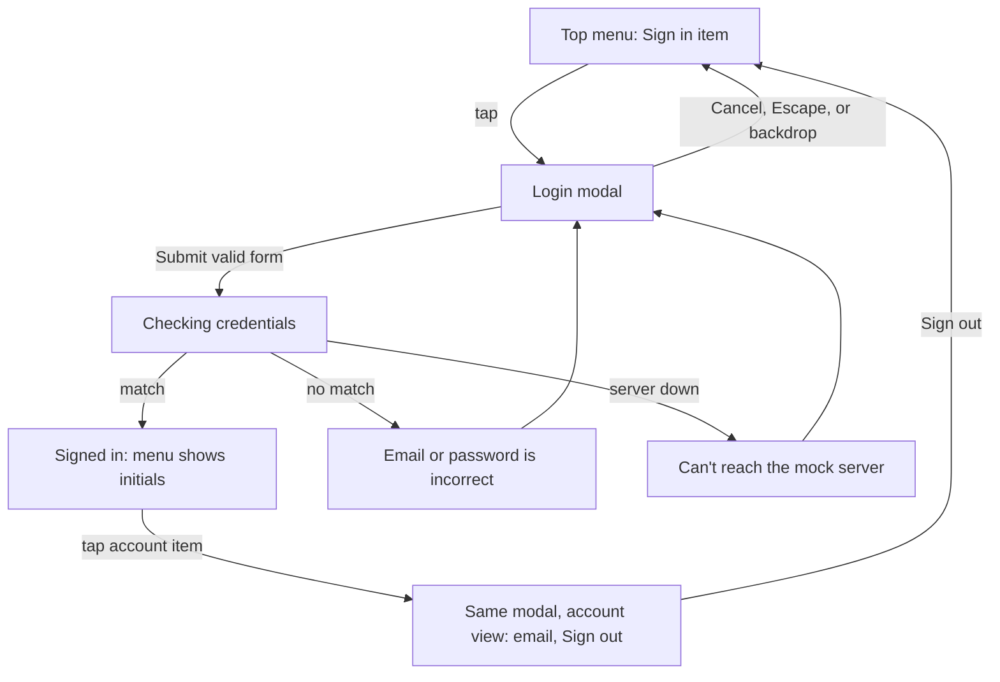

# V1 Frontend: Bugs and Next Steps (2026-10-22)

Follow-up to [frontend-plan.md](frontend-plan.md) after the first build.
Status: all plan items are implemented. `npx tsc --noEmit` and `npx expo lint` pass. This doc tracks bugs found during manual testing and the work left to do. **No fixes in this doc have been implemented yet.**

---

## 1. Bugs found in manual testing

### BUG-1: `<button>` cannot contain a nested `<button>` (History tab, web)

**Reported by:** Vidya, manual testing on web
**Symptom:** a console error appears when navigating to the History tab:

```
Console Error
<button> cannot contain a nested <button>.
See this log for the ancestor stack trace.
```

**When it happens:** only when the History list has at least one item. The loading, empty, and error states don't trigger it, because they don't render `TransmissionCard`.

**Root cause**

The whole history card is a `Pressable` with `accessibilityRole="button"`, and its footer row contains three more `Pressable`s that also have `accessibilityRole="button"` (Re-broadcast, Copy, Open). The outer one is in `src/components/transmission-card.tsx` at lines 60-62:

```tsx
<Pressable
  onPress={() => onPress(item)}
  accessibilityRole="button"
```

The inner ones come from the `ActionButton` helper in the same file, at lines 25-27:

```tsx
<Pressable
  onPress={onPress}
  accessibilityRole="button"
```

On web, React Native Web chooses the HTML element from the accessibility role. In `node_modules/react-native-web/dist/modules/AccessibilityUtil/propsToAccessibilityComponent.js`, the role-to-element table maps `button` to the HTML `<button>` element:

```js
var roleComponents = {
  // ...
  button: 'button',
  // ...
};
```

So each card renders as a real `<button>` element with three more `<button>` elements inside it. That's invalid HTML: a `<button>` may not contain interactive content. React DOM checks element nesting in development and logs this error.

**Rendered structure (simplified):**

```
<button aria-label="Sent text, 3m ago. Open details">        <- TransmissionCard
  ...header, payload, LinkNote...
  <div footer>
    <button aria-label="Re-broadcast">                        <- ActionButton
    <button aria-label="Copy">                                <- ActionButton
    <button aria-label="Open">                                <- ActionButton (https links only)
  </div>
</button>
```

**Why it matters (beyond the console noise)**
- **Accessibility:** screen readers usually announce a button's contents as one flat label, so the inner actions can be hidden or announced as part of "Open details". Keyboard Tab order and Enter/Space handling across nested buttons also behave inconsistently between browsers.
- **Event handling:** pressing an inner action depends on React Native Web's responder system to stop the outer card's press. That works today, but it's fragile and isn't how the DOM is meant to behave.
- **Server rendering risk:** `web.output` is `server`. If cards are ever rendered on the server (for example, if history data loads during server rendering later), the browser's HTML parser automatically closes the outer `<button>` when it reaches an inner one. That would cause hydration mismatches.

**Places checked that are NOT affected**
- `src/app/(tabs)/index.tsx` (Share): the `PrimaryButton`s are siblings, not nested.
- `src/app/history/[id].tsx` (Detail): the action buttons are siblings.
- `src/components/sheet.tsx`: the backdrop `Pressable` (`role=button`) is a sibling of the dialog card, not its parent.
- `src/components/app-tabs.web.tsx`: `TabTrigger asChild` wraps a `Pressable` that has no button role, and the tab buttons aren't nested.

**Suggested fix (not implemented)**

Restructure `TransmissionCard` so no interactive element contains another:
1. Make the card container a plain `View`, not a `Pressable`.
2. Wrap only the header and payload area in a `Pressable` with `accessibilityRole="button"` and the "Open details" label (or use expo-router `Link` with `asChild` to `/history/[id]`).
3. Keep the footer action row (status badge plus Re-broadcast, Copy, Open) as a **sibling** of that pressable area, inside the container `View`.
4. To keep the whole card visually tappable, move the pressed background color onto the container through state, or accept that only the upper area is tappable.

Avoid these:
- Removing `accessibilityRole="button"` from the outer card. The error goes away, but the card becomes a clickable `<div>` with no role, which hurts accessibility.
- Using `role="link"` or an `<a>` for the outer card. `<a>` also can't contain interactive content, so this just trades one invalid nesting for another.

**How to verify the fix:** open the History tab on web with seeded data, confirm the console error is gone, inspect the DOM to confirm no `button button` nesting, and tab through one card with the keyboard. Focus should go to "Open details", then Re-broadcast, Copy, and Open, each working on its own.

---

## 2. Known issues and risks (found during the build, not yet seen by a user)

| ID | Area | Issue | Severity | Notes |
| --- | --- | --- | --- | --- |
| RISK-1 | Testing | No in-browser click-through has been done yet. Only typecheck, lint, utility checks, and server-rendered page loads were verified. | High | Walk through the section 12 checklist in `frontend-plan.md` manually. |
| RISK-2 | Mock listening | Listening compares `createdAt` timestamps written by **each device's own clock**. Two browser tabs on one machine are fine, but physical devices with clock skew could miss broadcasts. | Medium (native only) | Options: a wider lookback window, or have the mock server stamp times (needs a json-server middleware or a custom server). |
| RISK-3 | Focus handling | `useStopOnLeave` depends on `useFocusEffect` firing blur events inside the `expo-router/ui` web tabs. Not yet confirmed in a browser. | Medium | Test: start Listen, switch to History, and confirm it stops. Also hide the browser tab and confirm it stops. |
| RISK-4 | Rate limit | The receive rate limit (5 per 10s) is effectively unused, because listening stops after the first message. | Low | Only matters if continuous listening is added later. |
| RISK-5 | Sensitive check | The keyword `pin` can cause false positives ("pin the slides"). | Low | Consider requiring nearby digits, or dropping `pin`. |
| RISK-6 | Theme | The `danger` button variant puts white text on `#FF6B5E` in dark mode, which is low contrast. The variant isn't used anywhere yet. | Low | Fix or remove the variant before using it. |
| RISK-7 | Clipboard on LAN | Copy fails on `http://<LAN IP>` origins (not a secure context). It shows a "Couldn't copy" toast. | Low | Expected. Documented in `frontend-plan.md` section 14. |
| RISK-8 | Dependencies | `npm audit` reports 21 vulnerabilities (3 moderate, 18 high), all in Expo tooling that existed before this work. json-server added none. | Low (dev tooling) | Revisit with the next Expo SDK patch release. Don't run `npm audit fix --force`, because it would break SDK version alignment. |
| RISK-9 | Docs | `README.md` still mentions `npm run reset-project` (script removed) and the template's explore screen. | Low | Rewrite the README with V1 run instructions. |
| RISK-10 | Native | iOS and Android were never run. The native tab bar (`app-tabs.tsx`) and `open-link.ts` (in-app browser) are untested. | Medium (when native is targeted) | Test in Expo Go after web is stable. |

---

## 3. Next steps (priority order)

1. **Fix BUG-1** by restructuring `TransmissionCard` as described above, then re-test History on web.
2. **Manual click-through on web** using the `frontend-plan.md` section 12 checklist:
   - Run `npm run mock-server` in one terminal and `npx expo start --web` in another.
   - Two-tab demo: broadcast in tab A, receive in tab B.
   - Security cases: try `javascript:`, `http:`, `tel:`, `apptesting://`, punycode links, bidi characters, and 500-character payloads. Seed records `seed-06` (`http:`) and `seed-08` (`javascript:`) cover some of these already.
   - Light and dark mode on all three screens.
   - Stop the mock server and confirm the error states and Retry.
3. **Confirm the stop-on-leave behavior** (RISK-3).
4. **Update `README.md`** with V1 setup: the `.env.local` / `.env.example` copy step, both npm scripts, the warning about the LAN script, and the two-tab demo (RISK-9).
5. **Small polish:** narrow the `pin` keyword (RISK-5), and fix or remove the `danger` button variant (RISK-6).
6. **Decide whether to add automated tests.** The project has no test runner today, and adding Jest (`jest-expo`) would be a new dependency, so that's your decision. The best candidates are `utils/payload.ts`, `utils/sensitive.ts`, and the type guards in `services/api.ts`.
7. **Native pass** (when targeted): Expo Go on iOS and Android, the Android emulator URL `10.0.2.2`, and the native tab bar icons (RISK-10). Address clock skew (RISK-2) before testing on physical devices.
8. **Later:** decide on an app icon (the decisions log keeps the default for now), and plan how a real data-over-sound engine replaces `MockSoundEngine` behind the `SoundEngine` interface.
9. **Build the login modal** (FEAT-1, section 4) after BUG-1 is fixed and the web click-through passes. Building it also means updating `frontend-plan.md`, which currently lists "Accounts, authentication" as out of scope.

---

## 4. Planned feature: FEAT-1 Login modal

**Status:** spec only, not built.
**Requested by:** Vidya, 2026-10-22.

### 4.1 Decisions

| Question | Decision |
| --- | --- |
| Separate page or modal? | **Modal only.** No new route, so nothing is added under `src/app/`. |
| Entry point | A clickable **account item in the top menu** (the web pill bar in `app-tabs.web.tsx`) |
| What sign-in does | **Checks credentials against a `users` collection in json-server** (mock backend) |
| Fields | **Email + password** |
| Gating | **None.** The app works the same signed in or out, and sign-in only changes the account display. |

### 4.2 User flow



### 4.3 UI spec

**Top menu item** (`src/components/app-tabs.web.tsx`, inside `CustomTabList`)
- Signed out: an outlined "Sign in" pill with a person icon, placed at the right end after the Share and History tabs.
- Signed in: a round orange avatar with the user's initials. Its accessibility label is "Account, signed in as <email>".
- It's a plain `Pressable` that opens the modal, **not** a `TabTrigger`, since it's not a route.
- Keep it a **sibling** of the tab triggers. Don't nest it inside another pressable (see BUG-1).

**Login modal** (new `src/components/login-modal.tsx`, built on the existing `Sheet` component)
- Title "Sign in to V1". Closes on Cancel, Escape, or a backdrop tap, the same as the other dialogs.
- Fields:
  - Email: `keyboardType="email-address"`, `autoCapitalize="none"`, `autoComplete="email"`, `textContentType="emailAddress"`
  - Password: `secureTextEntry`, `autoComplete="current-password"`, `textContentType="password"`, plus a show/hide toggle
- A fixed notice under the fields: **"Demo login only. Don't use a real password."** (see 4.6)
- Client-side validation before any request: email format, password not empty and at least 8 characters. Errors appear inline under each field.
- The "Sign in" button uses `PrimaryButton` with `loading` while the request runs. Enter submits on web.
- One generic error message for every failed attempt: **"Email or password is incorrect"**. It never says whether the email exists.
- Signed-in view (same modal): the email and display name, a "Signed in" note, a **Sign out** button, and Close.
- Toasts (fixed strings, following the existing toast rule): "Signed in", "Signed out", plus the existing "Couldn't reach the mock server".

**Native note:** native screens use a bottom tab bar and have no top menu. When native is targeted, put the same account item in the top-right of the Share and History screen headers. That's still a modal, with no new route.

### 4.4 Data and code changes

**Mock data** (`mock-server/db.seed.json`): add a `users` collection with 2 demo accounts. Store a salted SHA-256 hash, **never the plaintext password**:

```json
"users": [
  {
    "id": "user-demo-1",
    "email": "demo@v1.app",
    "displayName": "Demo User",
    "passwordSalt": "<random hex>",
    "passwordHash": "<sha256(salt + password) hex>"
  }
]
```

Document the demo passwords in the README only, and never commit real passwords.

**Generating seed hashes:** add `mock-server/hash-password.js`, which uses Node's built-in `crypto` (no install). It takes a password, creates a fresh random 16-byte salt with `crypto.randomBytes(16)`, and prints `passwordSalt` and `passwordHash` to paste into the seed. Run it once per demo account. See 4.4.1 for salting rules.

#### 4.4.1 Salting and hashing

Passwords are **salted and then hashed**, never hashed alone.

- **Hashing** turns a password into a fixed-length value that can't be reversed, so the stored record never contains the password itself.
- **Salting** adds a random value (the salt) to the password before hashing. Without a salt, two users with the same password get the same hash. An attacker can also look up common passwords in precomputed tables of hashes ("rainbow tables"). A unique salt per user defeats both.

**Rules for this mock:**
1. **One unique random salt per user.** Generate at least 16 bytes from a cryptographically secure source: Node `crypto.randomBytes` in the seed script, or `expo-crypto` `getRandomBytes` if accounts are ever created in the app. Never reuse a salt across users, and never use a constant or app-wide salt.
2. **Create a new salt whenever a password changes.** Don't keep the old salt.
3. **Store the salt next to the hash** (`passwordSalt` and `passwordHash` on the user record). A salt isn't secret; its job is to make each hash unique, not to hide anything.
4. **Hash input:** `passwordHash = SHA256(passwordSalt + password)`, hex-encoded. The app and `hash-password.js` must concatenate in the same order and use the same encoding (UTF-8 in, hex out).
5. **Compare in constant time.** Check the full hash strings without returning early on the first differing character. In a client-side mock, timing isn't a real attack surface, but write it the way the real server will need to.

**What changes for a real backend:**
- Use a **slow, memory-hard password hash with a built-in salt**: argon2id (preferred), bcrypt, or scrypt. These generate and store the salt inside the hash string, so there's no separate `passwordSalt` field. Fast hashes like SHA-256 are only acceptable here because this is a mock.
- Optionally add a **pepper**: a server-side secret mixed into every hash and stored outside the database (for example, in a secrets manager). Unlike a salt, a pepper **is** secret, so it must never appear in the client, the JS bundle, `EXPO_PUBLIC_*` variables, or `db.json`.
- Salting and hashing happen **only on the server**. The client sends the password over HTTPS and never receives a salt or hash.

**Types** (new `src/types/user.ts`):

```ts
export type User = { id: string; email: string; displayName: string };
type UserRecord = User & { passwordSalt: string; passwordHash: string }; // internal to api.ts
```

**API** (`src/services/api.ts`):
- `findUserByEmail(email)` calls `GET /users?email=<encoded>` and validates the result with a new `isUserRecord` type guard.
- `signIn(email, password)` reads the user's own `passwordSalt`, computes `SHA256(passwordSalt + password)` with `expo-crypto` `digestStringAsync`, compares it to `passwordHash` in constant time (see 4.4.1), and returns a `User` **without** the salt or hash. Any mismatch, or a missing user, throws one generic "invalid credentials" error.

**State** (new `src/state/auth.tsx`):
- An `AuthProvider` with `useAuth()` that exposes `{ user, signIn, signOut, status }`. Wrap it around the app in `src/app/_layout.tsx` next to `ToastProvider`.
- The session lives **in memory only**: no `localStorage`, `sessionStorage`, or secure storage. A reload signs the user out. This matches how `deviceId` works, and it keeps the mock session from looking like real auth.
- The password is never kept in context or state after submit. The modal clears the field on submit and on close.

**Components:**
- New `src/components/login-modal.tsx`
- New `src/components/account-button.tsx`, used by `app-tabs.web.tsx` now and by native screen headers later
- Add `person` and `logout` entries to `AppIcon`

**Dependencies:** none. `expo-crypto` is already installed.

### 4.5 Data model impact

Because sign-in gates nothing, the existing `Transmission` and `Broadcast` types **don't change**. Linking history to a user (an optional `userId`) is a separate future decision. If it happens, history still has to show "Unverified sender" for received items, because a mock login proves nothing about who sent a sound broadcast.

### 4.6 Security notes (important)

Checking credentials against json-server is a **demo pattern only**. Anyone on the network can read every record:

| # | Risk | Mitigation in this spec |
| --- | --- | --- |
| A1 | `GET /users` returns every user, including salts and hashes, to anyone who can reach the server | Demo accounts only, with the "Demo login only" notice in the UI. Default mock server binds to localhost. Never seed real emails or passwords. |
| A2 | Comparing in the client means the browser downloads the hash, which allows offline guessing | Accepted for a mock. A real backend must verify on the server and never return hashes. |
| A3 | Plain SHA-256 is too fast for password storage | Accepted for a mock. A real backend must use a slow hash (argon2id, bcrypt, or scrypt). |
| A3b | Unsalted or shared-salt hashes: identical passwords produce identical hashes, and precomputed rainbow tables can reverse common passwords | A unique random salt of at least 16 bytes per user, regenerated whenever the password changes, as specified in 4.4.1. No constant or app-wide salt. |
| A4 | Revealing which emails exist (user enumeration) | One generic error message for "no such user" and "wrong password". |
| A5 | Brute force | Client-side cooldown: after 5 failed attempts, disable Sign in for 30 seconds with a countdown. This is cosmetic only; the server must enforce real rate limits later. |
| A6 | Passwords leaking through logs or state | Never log the email or password (even under `__DEV__`). Clear the password field on submit and close. Never put credentials in toasts or URLs. |
| A7 | Session theft from storage | Session is kept in memory only and never persisted. |
| A8 | `digestStringAsync` needs a secure context on web | Works on `localhost`. It **fails** on `http://<LAN IP>`, the same limitation as the clipboard (RISK-7). Show "Sign-in needs a secure connection" in that case. |
| A9 | Sending credentials over cleartext HTTP | Development only. A real backend requires HTTPS. |

**Before any real launch:** replace this whole mechanism with a real auth provider or backend (server-side verification, argon2id/bcrypt hashing with per-user salts and an optional server-side pepper, HTTPS, server-enforced rate limits, and short-lived tokens in `expo-secure-store` on native). Treat the mock login as UI scaffolding only.

### 4.7 Acceptance checklist

- [ ] A "Sign in" item appears at the right of the top menu on web and opens the modal. No route or URL change happens.
- [ ] Escape, Cancel, and backdrop all close the modal and clear the password field.
- [ ] Invalid email format or a short password shows inline errors and sends no request.
- [ ] Demo credentials sign in. The menu shows initials, and a "Signed in" toast appears.
- [ ] A wrong password and an unknown email show the **same** error message.
- [ ] Every seeded user has a **different** `passwordSalt`. Two demo accounts given the same password still have different `passwordHash` values.
- [ ] `db.seed.json` contains no plaintext passwords, and no `password` field exists on any user record.
- [ ] The `User` object returned by `signIn` (and anything in auth state) contains no `passwordSalt` or `passwordHash`.
- [ ] After 5 failures, Sign in is disabled for 30 seconds.
- [ ] With the mock server stopped, the modal shows "Can't reach the mock server".
- [ ] Tapping the avatar opens the account view, and Sign out returns to the signed-out state.
- [ ] Reloading the page signs the user out (memory-only session).
- [ ] Share, Listen, and History work identically signed in or out.
- [ ] No `<button>`-in-`<button>` console errors from the new menu item (BUG-1 class).
- [ ] Light and dark mode both look correct, and the avatar's text contrast passes.
- [ ] `npx tsc --noEmit` and `npx expo lint` pass.

### 4.8 Open questions

- Should there be a "Create account" link in the modal, or are seeded demo accounts enough for now?
- Should the signed-in display name show anywhere besides the top menu (for example, the Share screen header)?
- When native is targeted, confirm the header placement in 4.3.

---

## 5. Environment notes from this session

- Installed per the plan: `expo-clipboard`, `expo-crypto` (via `npx expo install`), and `json-server@0.17` (dev dependency).
- `tsx` was run once through `npx` to check the utilities. It lives only in the npx cache and isn't a project dependency.
- A Playwright/Chromium install for browser testing was started and then **cancelled at the user's request**. Its temp folders were deleted, and no browser was installed.
- All dev processes (mock server and Expo dev server) were stopped at the end of the session.
- Policy going forward: **don't install anything without asking first.**
